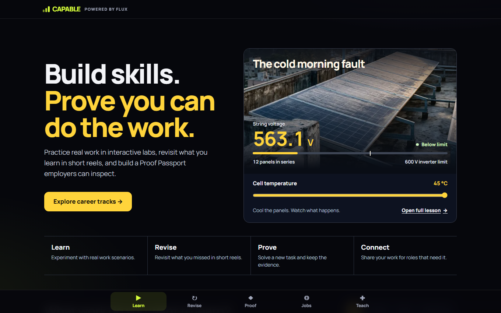
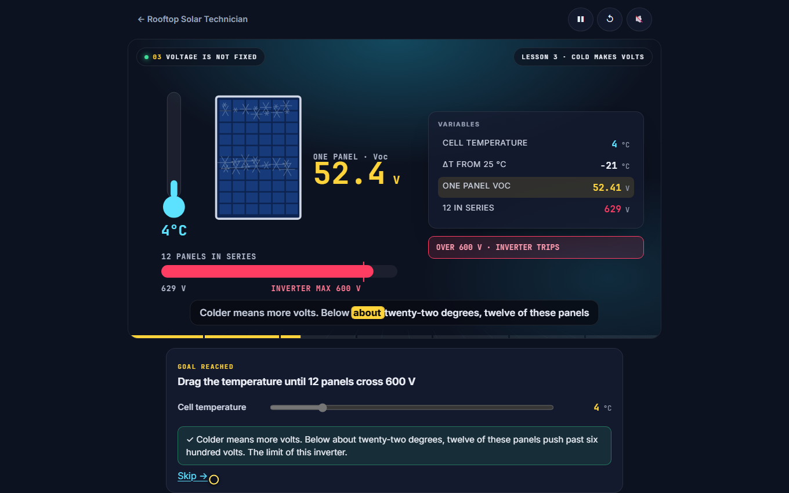
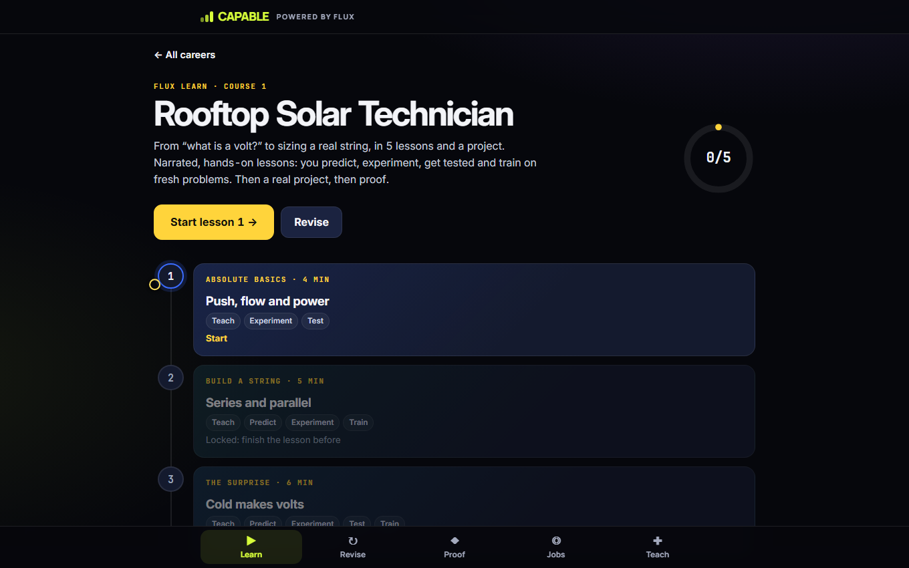
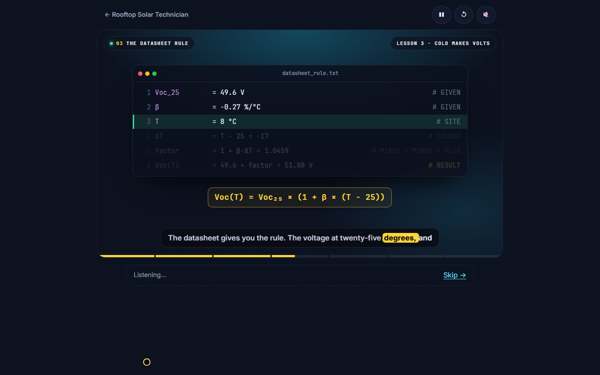
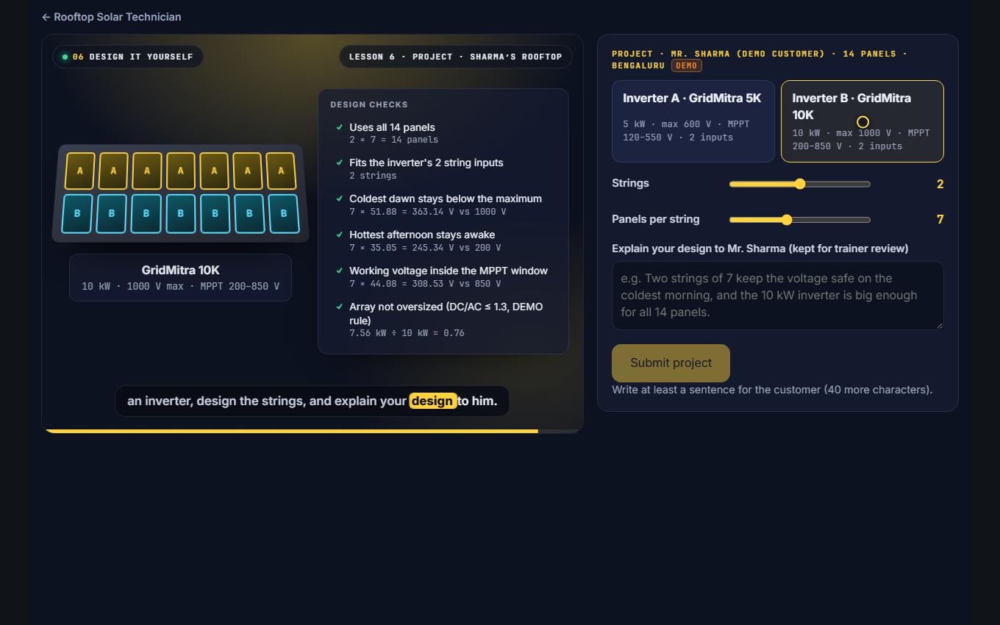

# CAPABLE

**Build skills. Prove you can do the work.**

CAPABLE is an experiential upskilling platform. **FLUX Learn** teaches a trade from absolute basics through narrated, hands-on lessons, then a real project. **FLUX Reels** revise what you learned before you forget it. The **Proof Passport** holds evidence from unseen tasks graded by code. **Opportunities** match that evidence to roles. **Field Scars** let experienced workers turn real site mistakes into lessons for the next learner.

> Learning creates understanding. Reels create retention. Assessments create evidence. Evidence creates opportunities.

**[Watch CAPABLE — The Proof Gap](docs/media/capable-launch.mp4)**. The launch film combines the live product walkthrough, animated workforce data, and the planned ElevenLabs voice layer. [Chapter list](docs/media/capable-launch-chapters.txt)



## Five career tracks

The homepage (`#/home`) lists every track and says how deep each one is today:

| Track | Field | Learning content today | Proof today |
|---|---|---|---|
| Rooftop Solar Technician | Trades | **Full FLUX Learn course:** 5 narrated lessons + project | 4 proof checks, including the project |
| EV Charger Installer | Trades | Interactive story lesson (6 min, JSON Lab Blueprint) | Unseen EV load work order |
| Payments Support Engineer | Tech | Interactive story lesson (5 min) | 2 unseen checks (duplicate webhooks, retry backoff) |
| Inventory & Stock Assistant | Operations | Lesson + work sample + trainer review | Reviewed worksheet |
| Dispatch & Payout Assistant | Operations | Diagnostic + adaptive lessons + worksheet | Reviewed worksheet |

Only solar has the full multi-lesson course so far. The same lesson engine (`course.ts` data + `scenes.tsx` + narration) is what the other tracks get next.



## The journey

| Stage | Experience | Route | What it does |
|---|---|---|---|
| 1 · Learn | **FLUX Learn** | `#/home` (careers) → `#/fl-course` → `#/fl-lesson?id=l1…l5` | A narrated cinematic lesson you take part in: cold open → teach → **predict** → **experiment** (live sliders with a goal) → rule as a line-by-line trace → **test** (hints, never just the answer) → **train** (fresh generated problems) |
| 2 · Build | **Project** | `#/fl-project` | Design Mr. Sharma's 14-panel roof: choose the inverter, lay out strings, pass every check, explain the design to the customer |
| 3 · Remember | **FLUX Reels** (Revise) | `#/flux-reels` | Short reels for concepts you already learned, on a 1 · 3 · 7 · 21-day schedule. Misses come back first next session. The quiz is optional ("just show me why") |
| 4 · Prove | **Proof Passport** | `#/sp-assess`, `#/sp-passport` | Unseen work orders and the project, graded by deterministic code, with the exact task, version, answers, mistakes and review status |
| 5 · Get hired | **Opportunities** | `#/sp-jobs`, `#/sp-employer` (DEMO) | One row per required skill, no hidden score. Share chosen records, revoke any time. Employers shortlist and invite to a supervised practical |
| ↺ Give back | **Field Scars** | `#/sp-teach` | Upload a real fault photo → safety and slop sieve → 2-of-3 master review → playable cards. Impact is counted from real events |

## FLUX Learn: the first course, *Rooftop Solar Technician*

 

| # | Lesson | Teach | Do |
|---|---|---|---|
| 1 | Push, flow and power *(absolute basics)* | Electricity as water: volts are push, amps are flow, watts are push × flow | Slide volts and amps to make 540 W; two checks |
| 2 | Series and parallel | Volts add in series; current adds in parallel | Predict a 3-panel string; build a string above 300 V; 3 training problems |
| 3 | Cold makes volts | The datasheet temperature rule: minus × minus = plus | Predict (the common wrong guess is named); drag the thermometer until 12 panels cross 600 V; trace; check; train |
| 4 | The inverter's window | Damage above the maximum, sleep below the MPPT minimum | Find the longest string that is safe at dawn and awake in the afternoon; round down / round up checks; train |
| 5 | Your first job ticket | The four-step method | A real work order, scaffolded step by step while your working fills in |
| ★ | Project | Everything together | Inverter choice, string layout, six live design checks, written explanation → Proof Passport |

**House style:** deep navy stage, a mood tint per lesson, a perspective grid floor, glass "variables" panels with rolling mono numbers, karaoke captions, and a narration voice (Google Chirp3-HD, `en-IN`) over a soft music bed. The lessons are rendered live in the browser as interactive scenes, not video files, so the learner can pause, replay a line, skip, or grab a slider.



## Honest by construction

- **No runtime AI.** Learning, grading and matching are deterministic TypeScript running offline. Every number on screen comes from `physics.ts` or the EV blueprint. `course.test.ts` checks that the narration says the same numbers the code computes.
- **No false awards.** Lessons, reels, watch time and memory meters never evidence a skill. Only the latest graded attempt at the current task version, with an intact fingerprint, counts.
- **Levels:** Practice · System-assessed · Trainer-reviewed (DEMO trainer, bound to attempt id and fingerprint, four-item checklist) · Identity-verified (not available, and the UI says so).
- **Share links:** the server re-grades from seed and raw answers, refuses forged grades, and returns 410 after the learner revokes the link.
- **Safety:** hazardous skills only earn a *supervised* practical. Site safety is checked in person and never marked as evidenced in the app.

## Run locally

Node.js 22.18+ and npm:

```sh
npm ci --prefix app
npm run demo --prefix app        # build + CAPABLE server (SQLite) on http://127.0.0.1:4173
```

| URL | What it does |
|---|---|
| `http://127.0.0.1:4173/#/home` | Homepage: all career tracks |
| `http://127.0.0.1:4173/#/fl-course` | The solar course map |
| `http://127.0.0.1:4173/#/home?demo=seed` | Seeded learner: lessons 1–4 done, one passed proof, one failed proof with a named mistake (all labelled DEMO SEED) |
| `http://127.0.0.1:4173/#/home?demo=reset` | Wipes this device |

No cloud credentials, paid APIs or separate database are needed to run it. All narration and media ship in `app/public/media/`.

Existing learner progress, evidence links, and local databases work with the CAPABLE build. The new server entry point is `scripts/capable_server.mjs`.

## Verify

```sh
npm run test:all --prefix app      # 49 FLUX (incl. curriculum + proof) · 35 engine · 8 moonshot
npm run lint --prefix app

node scripts/capable_server.mjs --port 4180 --data app/.data/demo.sqlite
export PLAYWRIGHT_MODULE=<playwright>/index.mjs SP_URL=http://127.0.0.1:4180 FLUX_URL=http://127.0.0.1:4180
node scripts/verify_learn.mjs       # course map → lesson 1 → lesson 3 → lesson 4 → guided ticket → project → passport
node scripts/verify_unlocked.mjs    # revise → proof → project → match → consent → employer → share link → revoke
node scripts/verify_flux.mjs        # story episodes + revision callbacks
node scripts/verify_flux_ugc.mjs    # Field Scars + EV blueprint
node scripts/record_demo.mjs        # records the demo and lays the app's narration under it
```

Executed results and known limitations: [reports/final/FINAL_QA.md](reports/final/FINAL_QA.md).

## Repository

| Path | Contents |
|---|---|
| [`app/src/flux/learn/`](app/src/flux/learn/) | **FLUX Learn**: `course.ts` (curriculum, goals, training generators: pure, tested), `Learn.tsx` (lesson player, course map, project), `scenes.tsx` (stage scenes), `script.json` + `vo.json` (narration) |
| [`app/src/sp/`](app/src/sp/) | CAPABLE shell: Learn · Revise · Proof · Jobs · Teach, plus the employer seat and the public share-link viewer |
| [`app/src/flux/`](app/src/flux/) | FLUX engine: `physics.ts`, `memory.ts`, `assess.ts` (seeded graders + project checks, shared with the server), `passport.ts`, `skills.ts`, `goal.ts`, reels, story episodes, Field Scars, Lab Blueprints |
| [`scripts/course_tts.py`](scripts/course_tts.py) | Narration (Chirp3-HD) and music bed, cost-logged and cached |
| [`scripts/capable_server.mjs`](scripts/capable_server.mjs) | Static server + SQLite API: sync, trainer review, `/api/proof/share`, `/api/proof/revoke`, `GET /api/proof/public/<token>` |
| [`reports/final/`](reports/final/) | Submission docs and screenshots |

[Final product](reports/final/FINAL_PRODUCT.md) · [Demo script](reports/final/DEMO_SCRIPT.md) · [Pitch content](reports/final/PITCH_CONTENT.md) · [Pilot plan](reports/final/PILOT_PLAN.md) · [Final QA](reports/final/FINAL_QA.md) · [FLUX engine notes](reports/flux/README.md)

## Boundaries

- Employers, candidates, listings, pay, the trainer, Mr. Sharma and invites are **DEMO** and run on the same device. Nothing is sent, and no invite is a job offer.
- One full course exists (rooftop solar). EV and payments are single story lessons; inventory and dispatch are the earlier work-sample paths.
- Narration is English (Indian English voice). There is no Kannada pathway for the new course yet.
- Identity is not verified. No learning gains, placements or business metrics have been measured yet; that is the [pilot](reports/final/PILOT_PLAN.md)'s job.
- Media spend to date: $4.45 of a $5 cap, all logged.
