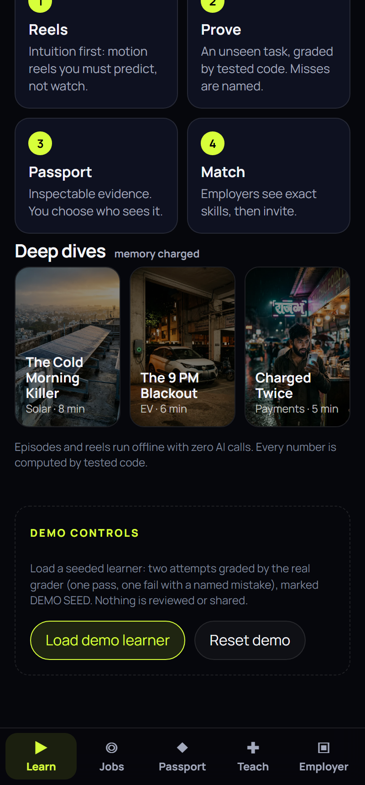
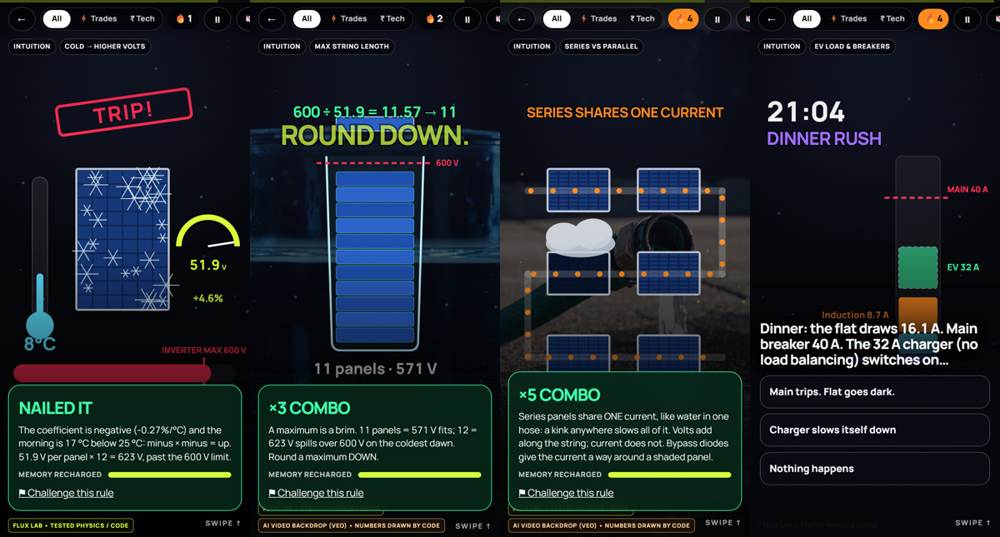
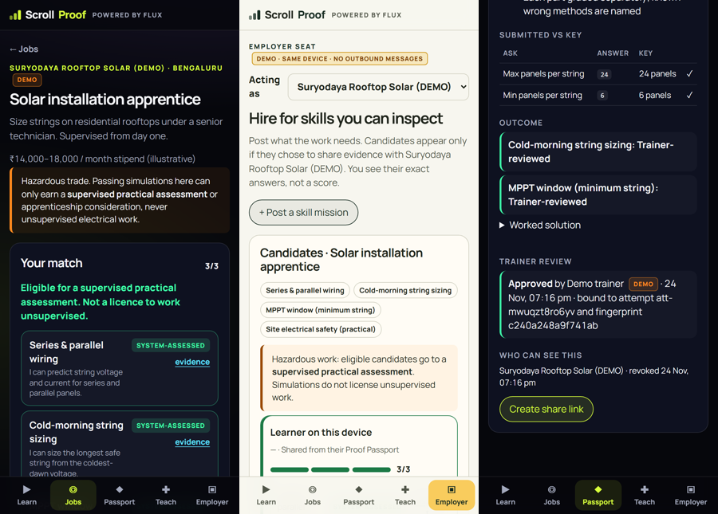

# ScrollProof

**Turn everyday scrolling into employability.** Pick a job and your reel feed becomes the shortest path to it. Prove each skill on a task you have never seen, keep the evidence in a Proof Passport, and choose which employer sees it.

ScrollProof is the product. **FLUX** is its learning and verification engine. Learning, grading and matching run offline as deterministic TypeScript, with no AI calls at runtime.

<p>

</p>

## The loop

```
Pick a job → goal-directed reels → unseen proof task → Proof Passport → consented employer view → supervised practical / interview invite
                                                                                   ↑
                                         experienced workers upload Field Scars ───┘
```

| Seat | Route | What happens |
|---|---|---|
| **Learn** | `#/home` | Pick a goal job and see exactly which skills it needs and which ones are proven. Open the goal feed. |
| **Feed** | `#/flux-reels?goal=<job>` | 10-second intuition reels aimed at missing skills. Every card shows *why* it is in your feed. A proof slot follows each gap. |
| **Prove** | `#/sp-assess?c=<skill>` | A new task generated from a seed and graded by code. Known wrong methods are named. |
| **Passport** | `#/sp-passport` | Task, version, rubric, raw answers vs key, misconceptions, fingerprint, review status, who can see it. |
| **Jobs** | `#/sp-jobs` | Explainable match: one row per requirement, no hidden score. Share chosen records with one employer and revoke any time. |
| **Teach** | `#/sp-teach` | Field Scars: upload a real site fault → safety and slop sieve → 2-of-3 master review → playable cards. Impact is counted from real events only. |
| **Employer** (DEMO) | `#/sp-employer` | Post a skill mission, see consenting candidates, inspect their answers, shortlist, invite. |

## Intuition reels (motion graphics, not memes)



Each reel runs about 10 seconds:
1. **Setup.** About 5 seconds of kinetic type and an animated diagram. Tap to skip.
2. **Forced prediction.** The options appear and a timer starts. The feed cannot be scrolled past passively.
3. **Payoff.** The animation shows *why* the answer is right.

| Reel | Concept | The intuition |
|---|---|---|
| Cold → more volts | solar Voc vs temperature | Frost grows, the needle climbs, a 12-panel string crosses 600 V and trips |
| The cliff | max string length | 11 panels fit in the "glass"; the 12th overflows, so a maximum rounds down |
| Heat sags volts | min string length | 3 panels sleep under the MPPT wake line; the 4th wakes it, so a minimum rounds up |
| One hose | series current | One shaded panel halves the current of the whole string; bypass diodes give it a way around |
| The 9 PM blackout | EV load | Dinner loads stack up, a 32 A charger trips the 40 A main, and load balancing fits the charger into what is left |
| Same key, one charge | idempotency | The reply is cut, the retry carries the same key, and the server replays its reply |
| The thundering herd | retries | Synchronised retries keep a server down; backoff plus jitter spreads them out |

Every number is computed at runtime from `physics.ts` or the EV blueprint. None is baked into media. Two Veo clips (water at the brim, a hose) are atmospheric backdrops only, and each card that uses one is badged **AI VIDEO BACKDROP (VEO) • NUMBERS DRAWN BY CODE**. Reduced-motion users get the final frame and the same forced decision.

## Proof, not certificates



- **No false awards.** Reels, watch time and memory meters never evidence a skill. Only the latest graded attempt counts, and only at the current task version with an intact fingerprint.
- **Levels:** Practice · System-assessed · Trainer-reviewed (bound to attempt id and fingerprint, four-item checklist; a new attempt detaches it) · Identity-verified (not available in this prototype, and the UI says so).
- **Share links:** the server re-grades from seed and raw answers, refuses forged grades, and returns 410 after the learner revokes the link.
- **Safety:** any hazardous competency forces a supervised outcome. Site safety is checked in person only and never marked as evidenced in the app.

## Run locally

Use Node.js 22.18 or later and npm.

```sh
npm ci --prefix app
npm run demo --prefix app        # build + ScrollProof server (SQLite) on http://127.0.0.1:4173
```

- `http://127.0.0.1:4173/#/home?demo=seed` loads a reproducible demo learner: two attempts graded by the real grader, labelled DEMO SEED.
- `http://127.0.0.1:4173/#/home?demo=reset` wipes this device.

`npm start --prefix app` serves an existing build. `vite preview` works too, but share links then need the server.

The demo uses bundled media and synthetic data. It needs no cloud credentials, paid APIs or separate database.

## Verify

```sh
npm run test:all --prefix app     # FLUX 44 · engine 35 · moonshot 8 unit tests
npm run lint --prefix app

# browser walkthroughs (server running on :4180, Playwright installed)
node scripts/scrollproof_server.mjs --port 4180 --data app/.data/demo.sqlite
PLAYWRIGHT_MODULE=<playwright>/index.mjs SP_URL=http://127.0.0.1:4180   node scripts/verify_unlocked.mjs   # 30-step learner→employer path
PLAYWRIGHT_MODULE=<playwright>/index.mjs FLUX_URL=http://127.0.0.1:4180 node scripts/verify_flux.mjs       # episodes + reels regression
PLAYWRIGHT_MODULE=<playwright>/index.mjs FLUX_URL=http://127.0.0.1:4180 node scripts/verify_flux_ugc.mjs   # Field Scars + EV blueprint
PLAYWRIGHT_MODULE=<playwright>/index.mjs SP_URL=http://127.0.0.1:4180   node scripts/record_demo.mjs       # silent 163 s demo video
```

The executed results and known limitations are in [reports/final/FINAL_QA.md](reports/final/FINAL_QA.md).

## Repository

| Path | Contents |
|---|---|
| [`app/src/sp/`](app/src/sp/) | ScrollProof shell: Learn, Jobs, Prove, Passport, Teach, Employer seat, public share-link viewer |
| [`app/src/flux/`](app/src/flux/) | FLUX engine and UI: episodes, reels, Field Scars, Lab Blueprints, Scroll Fuel |
| `app/src/flux/skills.ts` · `assess.ts` · `passport.ts` · `goal.ts` | Pure, tested core: competency graph and DEMO jobs, seeded graders (shared with the server), evidence and consent, goal-feed ranking |
| [`app/src/flux/motion/`](app/src/flux/motion/) | Motion reel engine and the seven scenes |
| [`scripts/scrollproof_server.mjs`](scripts/scrollproof_server.mjs) | Static server + SQLite API: sync, trainer review, `/api/proof/share`, `/api/proof/revoke`, `GET /api/proof/public/<token>` |
| [`scripts/flux_media.py`](scripts/flux_media.py) · [`scripts/motion_plates.py`](scripts/motion_plates.py) | One-off media generation (images, Veo, TTS) through the cost ledger; cached and reused at $0 |
| [`extension/`](extension/) · [`android-gate/`](android-gate/) | Scroll Fuel browser extension; Android overlay skeleton (not compiled) |
| [`app/src/careers/`](app/src/careers/) · [`moonshot/`](moonshot/) | Earlier inventory and payout career path (`#/careers`) and its experiments |
| [`core/`](core/), [`reports/`](reports/) | Feasibility lab tooling and write-ups |

## Submission documents

[Final product](reports/final/FINAL_PRODUCT.md) · [Demo script (165 s)](reports/final/DEMO_SCRIPT.md) · [Pitch content](reports/final/PITCH_CONTENT.md) · [Pilot plan](reports/final/PILOT_PLAN.md) · [Final QA](reports/final/FINAL_QA.md) · [FLUX engine](reports/flux/README.md) · [Design system](DESIGN.md)

## Honest boundaries

- Employers, candidates, listings, pay figures, the trainer and invites are **DEMO** and run on the same device. Nothing is sent, and no invite is a job offer.
- Identity is not verified. The fingerprint detects edits to a record; it does not prove who took the task.
- A pass on an electrical skill qualifies someone for a **supervised** practical only.
- The FLUX and motion pathway is English-only. Kannada exists only for the older inventory path and still needs fluent review.
- No learning gains, placements or business metrics have been measured yet. That is what the [pilot](reports/final/PILOT_PLAN.md) is for.
- Media spend so far: $4.35 of a $5 cap, all logged in the cost ledger.
