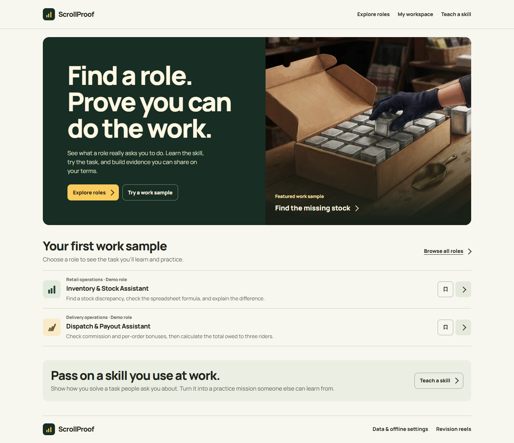

# ScrollProof

**Find a role. Prove you can do the work.**

ScrollProof is a mobile-first prototype for people preparing for their first job. Pick a role, practice a task it requires, and complete a new work sample. A trainer can review that exact submission, and the learner controls its demo employer preview. Local workers and trainers can turn tasks they already teach into practice material for the next learner.



## Run locally

Use Node.js 22.18 or later and npm. From the repository root:

```sh
npm ci --prefix app
npm run build --prefix app
npm start --prefix app
```

Open [http://127.0.0.1:4173](http://127.0.0.1:4173). The server serves the built app and the SQLite-backed review API on the same origin. The core demo uses bundled media and synthetic data. It runs without cloud credentials, paid APIs, or a separate database installation.

## Try the demo

1. Open **Explore roles** and choose **Inventory & Stock Assistant**. Start learning, then compare expected stock with the physical count. Try **Practice** to see feedback and a short recall exercise for a common mistake.
2. Open **Work sample** and solve a worksheet with different figures. After the app reports **Offline ready**, the lesson and worksheet can run without a connection. Review sync resumes when the server is reachable.
3. Open **Evidence**, send the worksheet for review, and record a demo trainer review. Enable the optional preview, then turn it off to see consent take effect.
4. Open **My workspace** to see your work. Add a job you found elsewhere, choose a matching practice track, and track whether you applied.

**Dispatch & Payout Assistant** uses a diagnostic, an adaptive lesson path, and a fresh rider payout worksheet. **Teach a skill** opens the contributor flow for turning an inventory example into a reviewed lesson.

## What’s in the repository

| Path | Contents |
| --- | --- |
| [`app/`](app/) | React and TypeScript PWA, role discovery, job workspace, learning and assessment, offline delivery, and demo review screens |
| [`scripts/`](scripts/) | Local HTTP and SQLite server, browser checks, and experiment commands |
| [`moonshot/`](moonshot/) | Inventory workflows, synthetic fixtures, media, and experience compiler benchmarks |
| [`reel/`](reel/) | Remotion source and media for the video demos |
| [`core/`](core/) and [`reports/`](reports/) | Media and research tooling, evaluation results, and experiment write-ups |

[Product direction and pilot](PRODUCT.md) · [UI design system](DESIGN.md) · [App configuration and browser tests](app/README.md) · [Moonshot experiments](reports/moonshot/README.md)

## Verify

```sh
npm run test:engine --prefix app
npm run test:moonshot --prefix app
npm run lint --prefix app
```

The practice roles are demos. Personal job leads and application markers are stored on the learner’s device, and applications happen on the original job sites. Reviews are tied to a submission, identity remains unverified, and the employer preview is on the same device. The first proposed pilot would measure whether a reviewed stock worksheet helps first-time applicants earn an interview with local retailers.
